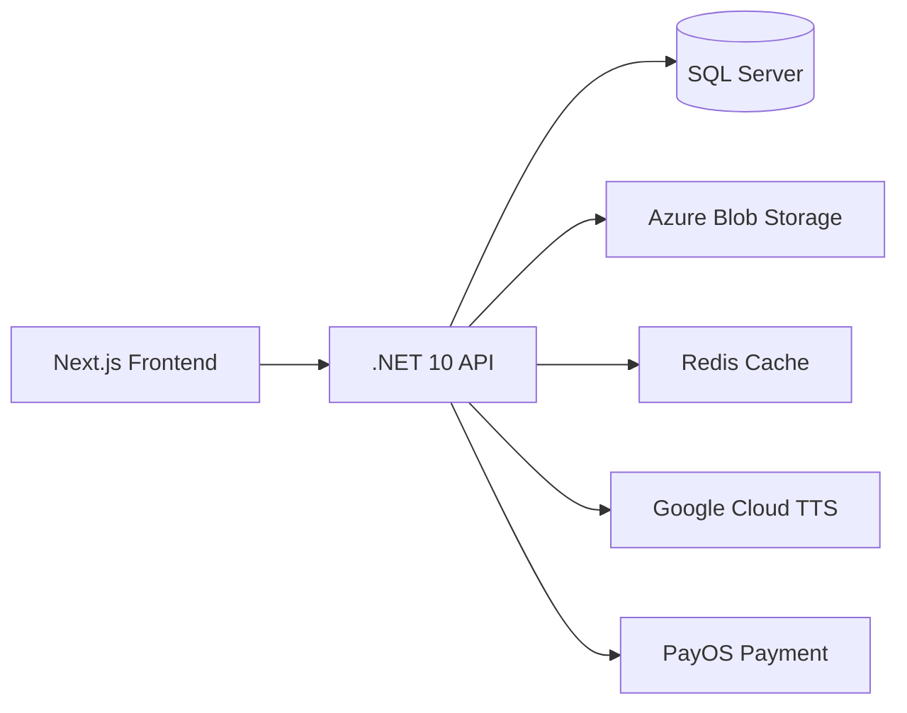

# ToeicMaster

Nền tảng luyện thi TOEIC trực tuyến toàn diện, hỗ trợ học viên luyện tập Reading, Grammar, Vocabulary và làm bài Test với trải nghiệm hiện đại, có AI giải thích chi tiết.

## Kien Truc Du An

```
ToeicMaster/
├── ToeicMaster.API/        # Backend API (.NET 10)
├── toeic-web/              # Frontend Web (Next.js 16)
├── docker-compose.yml      # Docker Compose cho development
└── README.md
```



## Tinh Nang Chinh

### Luyen Tap
- **Reading Practice** – Luyện đọc Part 6 & 7 với hệ thống passage, câu hỏi và giải thích chi tiết
- **Grammar Practice** – Luyện ngữ pháp TOEIC theo từng chủ điểm (thì, câu điều kiện, mệnh đề quan hệ...)
- **Vocabulary Practice** – Học từ vựng theo chủ đề, có phát âm chuẩn (Google TTS)
- **Full Test** – Làm bài thi TOEIC đầy đủ 7 parts, tính điểm tự động

### AI Thong Minh
- Giải thích đáp án chi tiết bằng AI cho cả Reading và Grammar
- Hỗ trợ sinh câu hỏi tự động cho Admin

### Premium
- Gói Premium mở khóa toàn bộ nội dung cao cấp
- Tích hợp thanh toán qua **PayOS** (QR Code)
- Quản lý subscription linh hoạt

### Theo Doi Tien Do
- Thống kê điểm số, thời gian làm bài
- Lịch sử luyện tập Reading
- Biểu đồ tiến bộ Grammar và Vocabulary
- Bookmark câu hỏi khó để ôn lại

### Admin Panel
- Quản lý người dùng, bài test, câu hỏi
- Dashboard thống kê tổng quan
- Import/Export dữ liệu (Excel)
- Quản lý nội dung Reading Passages
- Cấu hình gói Premium

### PWA (Progressive Web App)
- Cài đặt trên mobile/desktop như app native
- Hỗ trợ offline mode
- Trải nghiệm mượt mà như native app

## Cong Nghe Su Dung

### Backend (ToeicMaster.API)
| Công Nghệ | Mục Đích |
|-----------|----------|
| .NET 10 | Web API Framework |
| Entity Framework Core 10 | ORM với SQL Server |
| Dapper | Micro ORM cho query hiệu năng cao |
| JWT Authentication | Xác thực người dùng |
| Azure Blob Storage | Lưu trữ file (audio, ảnh) |
| Redis | Cache và session |
| Google Cloud TTS | Text-to-Speech cho từ vựng |
| PayOS | Thanh toán online |
| BCrypt | Mã hóa mật khẩu |
| Swagger/OpenAPI | API Documentation |
| EPPlus | Import/Export Excel |

### Frontend (toeic-web)
| Công Nghệ | Mục Đích |
|-----------|----------|
| Next.js 16 | React Framework (App Router) |
| React 19 | UI Library |
| TypeScript 5 | Type Safety |
| Tailwind CSS 4 | Utility-first CSS |
| next-pwa | Progressive Web App |
| Axios | HTTP Client |
| Lucide React | Icons |
| Sonner / React Hot Toast | Notifications |
| React Markdown | Render markdown content |
| next-themes | Dark/Light mode |

## Cai Dat & Chay

### Yêu cầu hệ thống
- [.NET 10 SDK](https://dotnet.microsoft.com/download/dotnet/10.0)
- [Node.js 20+](https://nodejs.org/)
- [Docker Desktop](https://www.docker.com/products/docker-desktop/) (khuyên dùng)
- [SQL Server 2022](https://www.microsoft.com/sql-server) (nếu không dùng Docker)

### Chạy với Docker (Khuyến nghị)

```bash
# Clone project
git clone <repository-url>
cd ToeicMaster

# Khởi động toàn bộ stack (SQL Server + API + Web)
docker-compose up -d

# Truy cập:
# Frontend: http://localhost:3000
# API Swagger: http://localhost:5000/swagger
```

### Chạy thủ công (Development)

#### 1. SQL Server
Đảm bảo SQL Server đang chạy và tạo database `ToeicMasterDb`.

#### 2. Backend API
```bash
cd ToeicMaster.API

# Cấu hình connection string trong appsettings.json
# Chạy migration
dotnet ef database update

# Chạy API
dotnet run
# API chạy tại http://localhost:5000
```

#### 3. Frontend Web
```bash
cd toeic-web

# Cài dependencies
npm install

# Tạo file .env.local với nội dung:
# NEXT_PUBLIC_API_URL=http://localhost:5000

# Chạy development server
npm run dev
# Web chạy tại http://localhost:3000
```

## Cau Truc Database

Các migration SQL quan trọng nằm trong thư mục gốc:
- `migration.sql` – Migration cơ bản
- `grammar_progress_migration.sql` – Bảng theo dõi tiến độ Grammar
- `reading_passages_difficulty.sql` – Độ khó Reading Passage
- `reading_practice.sql` – Bảng Reading Practice (Part 6 & 7)
- `reading_topics.sql` – Chủ đề Reading
- `reading_uuid_migration.sql` – UUID migration
- `vocabSQL.md` / `grammarSQL.md` – Schema Vocabulary & Grammar

## Trien Khai (Deployment)

### Backend
- **Render**: Sử dụng `ToeicMaster.API/render.yaml`
- **Azure App Service**: Hỗ trợ triển khai qua Docker

### Frontend
- **Vercel**: Triển khai tự động từ repository (recommended)
- **Docker**: Sử dụng `toeic-web/Dockerfile`

### Environment Variables

#### Backend (`appsettings.json`)
```json
{
  "ConnectionStrings": {
    "DefaultConnection": "Server=...;Database=ToeicMasterDb;..."
  },
  "Jwt": {
    "Key": "your-jwt-secret-key",
    "Issuer": "ToeicMaster",
    "Audience": "ToeicMaster"
  },
  "PAYOS_CLIENT_ID": "",
  "PAYOS_API_KEY": "",
  "PAYOS_CHECKSUM_KEY": "",
  "AzureStorage": {
    "ConnectionString": ""
  }
}
```

#### Frontend (`.env.local`)
```env
NEXT_PUBLIC_API_URL=http://localhost:5000
```

## Cau Truc Thu Muc Quan Trong

### Backend
```
ToeicMaster.API/
├── Controllers/          # API Controllers (30+ endpoints)
├── Data/                 # DbContext, DapperContext
├── Entities/             # Entity Framework Models
├── Models/               # DTOs, Request/Response Models
├── Services/             # Business Logic Services
├── Migrations/           # EF Core Migrations
└── Credentials/          # Google Cloud credentials
```

### Frontend
```
toeic-web/app/
├── admin/                # Admin Dashboard
├── components/           # Shared UI Components
├── contexts/             # React Contexts (Auth, Theme)
├── grammar/              # Grammar Practice Pages
├── login/register/       # Authentication Pages
├── practice/             # General Practice
├── profile/              # User Profile
├── reading/              # Reading Practice (Part 6 & 7)
├── subscription/         # Premium Subscription
├── tests/                # Full TOEIC Tests
├── vocabulary/           # Vocabulary Learning
├── services/             # API Client Services
└── lib/                  # Utility Functions
```

## 🔐 Xác Thực & Phân Quyền

- **JWT Bearer Token** cho API Authentication
- **Google OAuth** login (frontend)
- Role-based authorization: `User`, `Premium`, `Admin`
- Tự động refresh token

## 📝 License

Dự án thuộc sở hữu của ToeicMaster. Mọi quyền được bảo lưu.

---

<p align="center">
  <b>ToeicMaster</b> – Nền tảng luyện thi TOEIC hiện đại, thông minh, hiệu quả.
</p>
