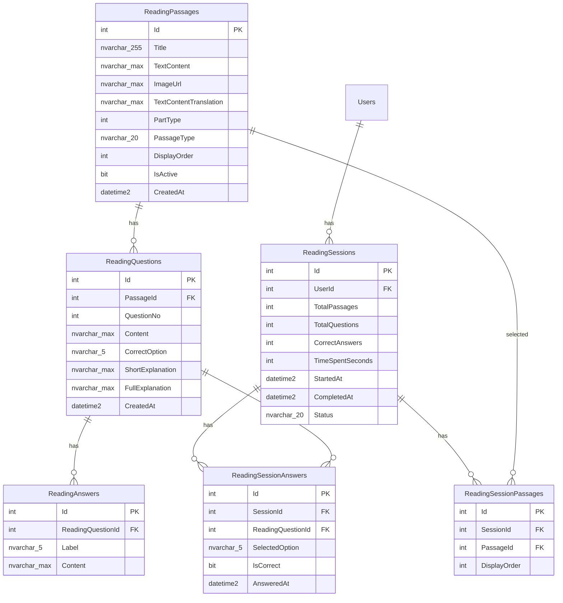
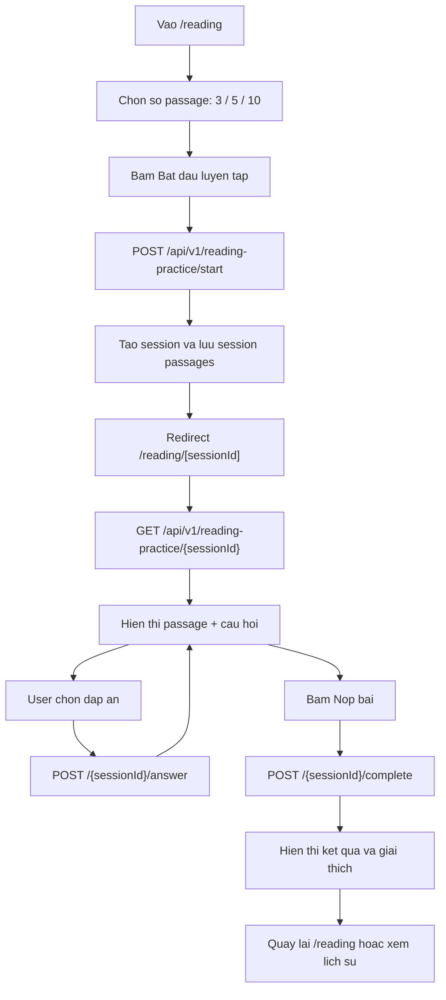

# Implementation Plan: Reading Practice Part 6 & 7

Muc tieu: tao he thong **Reading Practice** rieng cho Part 6 va Part 7, tach khoi luong lam bai Test hien tai. User vao trang Reading, chon so luong passage, lam bai, nop bai, xem ket qua va lich su luyen tap.

> Ghi chu trien khai: database se dung **SQL script thu cong** de ban paste va chay truc tiep. Khong bat buoc tao EF migration o buoc dau.

---

## 1. Nguyen tac thiet ke

- Reading Practice khong dung chung cac bang Test nhu `Tests`, `Parts`, `QuestionGroups`, `Questions`, `Answers`, `TestAttempts`, `UserAnswers`.
- Reading Practice van duoc phep dung chung ha tang san co nhu `Users`, JWT auth, `AppDbContext`, `axiosClient`, `PageHeader`, layout chung.
- Du lieu reading duoc nhap rieng vao cac bang moi bang SQL script.
- Session phai luu duoc danh sach passage da random de user reload trang hoac xem lai ket qua van dung du lieu ban dau.

---

## 2. Database - Bang moi

Can tao **6 bang moi**, khong phai 5 bang. Bang bo sung quan trong la `ReadingSessionPassages` de luu passage nao thuoc session nao.



### Bang va muc dich

| Bang | Muc dich |
| --- | --- |
| `ReadingPassages` | Luu bai doc rieng cho Part 6/7. |
| `ReadingQuestions` | Luu cau hoi thuoc passage. |
| `ReadingAnswers` | Luu 4 dap an A/B/C/D cho moi cau hoi. |
| `ReadingSessions` | Luu phien luyen tap cua user. |
| `ReadingSessionPassages` | Luu danh sach passage da chon cho session, theo thu tu hien thi. |
| `ReadingSessionAnswers` | Luu cau tra loi cua user trong session. |

### Quy tac SQL can co

- `ReadingPassages.PartType` chi nhan `6` hoac `7`.
- `ReadingPassages.PassageType` dung `single`, `double`, `triple`; mac dinh `single`.
- Khong dung ten cot `Order`; dung `DisplayOrder` de tranh dung keyword SQL.
- `ReadingSessions.Status` dung `in_progress` hoac `completed`.
- Nen co unique constraint:
  - `ReadingAnswers(ReadingQuestionId, Label)`
  - `ReadingSessionPassages(SessionId, PassageId)`
  - `ReadingSessionAnswers(SessionId, ReadingQuestionId)`
- Nen co index:
  - `ReadingPassages(PartType, IsActive)`
  - `ReadingQuestions(PassageId)`
  - `ReadingAnswers(ReadingQuestionId)`
  - `ReadingSessions(UserId, StartedAt)`
  - `ReadingSessionAnswers(SessionId)`

---

## 3. Backend

### Files moi

| File | Muc dich |
| --- | --- |
| `Entities/ReadingPassage.cs` | Entity cho `ReadingPassages`. |
| `Entities/ReadingQuestion.cs` | Entity cho `ReadingQuestions`. |
| `Entities/ReadingAnswer.cs` | Entity cho `ReadingAnswers`. |
| `Entities/ReadingSession.cs` | Entity cho `ReadingSessions`. |
| `Entities/ReadingSessionPassage.cs` | Entity cho `ReadingSessionPassages`. |
| `Entities/ReadingSessionAnswer.cs` | Entity cho `ReadingSessionAnswers`. |
| `Controllers/ReadingPracticeController.cs` | Controller rieng cho Reading Practice. |

### Cap nhat file co san

| File | Thay doi |
| --- | --- |
| `Data/AppDbContext.cs` | Them 6 `DbSet` va cau hinh relationship/index/check/default tuong ung. |
| `Entities/User.cs` | Them navigation collection `ReadingSessions` neu can dung EF navigation. |

### API endpoints

Base route: `/api/v1/reading-practice`

| Method | Route | Muc dich |
| --- | --- | --- |
| `GET` | `/passages` | Admin/preview danh sach passage reading. Nen yeu cau admin hoac auth. |
| `POST` | `/start` | Tao session, random passage Part 6/7 dang active, luu vao `ReadingSessionPassages`. |
| `GET` | `/{sessionId}` | Lay lai session dang lam hoac da hoan thanh, gom passage, question, answer, selected answer. |
| `POST` | `/{sessionId}/answer` | Luu hoac cap nhat cau tra loi tung cau. |
| `POST` | `/{sessionId}/complete` | Ket thuc session, tinh tong dung/sai/thoi gian. |
| `GET` | `/history` | Lich su luyen Reading cua user. |
| `GET` | `/stats` | Thong ke tong quan Reading Practice cua user. |

### Request/response chinh

`POST /start`

```json
{
  "passageCount": 5
}
```

Rules:

- `passageCount` chi cho phep `3`, `5`, hoac `10`.
- Random tu `ReadingPassages` co `IsActive = 1` va `PartType IN (6, 7)`.
- Tao `ReadingSessions` voi status `in_progress`.
- Tao `ReadingSessionPassages` de co dinh danh sach passage cua session.
- Tra ve `sessionId` va du lieu de frontend redirect sang `/reading/[sessionId]`.

`POST /{sessionId}/answer`

```json
{
  "readingQuestionId": 123,
  "selectedOption": "A"
}
```

Rules:

- Chi cho phep user tra loi session cua chinh ho.
- Chi cho phep cap nhat khi session con `in_progress`.
- Neu cau da co answer thi update, chua co thi insert.
- `IsCorrect` tinh bang cach so sanh `SelectedOption` voi `CorrectOption`.

`POST /{sessionId}/complete`

```json
{
  "timeSpentSeconds": 620
}
```

Rules:

- Set `Status = completed`.
- Set `CompletedAt`.
- Tinh `CorrectAnswers` tu `ReadingSessionAnswers`.
- `TotalQuestions` lay theo cac question thuoc passage trong `ReadingSessionPassages`.

---

## 4. Frontend

### Routes moi

| Route | File | Muc dich |
| --- | --- | --- |
| `/reading` | `app/reading/page.tsx` | Trang chon so passage, bat dau luyen, xem lich su va thong ke. |
| `/reading/[sessionId]` | `app/reading/[sessionId]/page.tsx` | Trang lam bai, nop bai, xem ket qua. |

### Components moi

Tao thu muc `app/components/reading/`.

| File | Muc dich |
| --- | --- |
| `ReadingPassageView.tsx` | Hien thi passage ben trai, ho tro HTML content va image neu co. |
| `ReadingQuestionList.tsx` | Hien thi danh sach cau hoi va dap an. |
| `ReadingResultView.tsx` | Hien thi ket qua sau khi nop bai. |
| `ReadingHistoryList.tsx` | Hien thi lich su luyen Reading. |
| `ReadingSessionSidebar.tsx` | Hien thi tien do passage/cau hoi va timer. |

### Service va types

| File | Thay doi |
| --- | --- |
| `app/services/readingService.ts` | Goi cac API `/reading-practice/...`. |
| `app/types.ts` | Them `ReadingPassage`, `ReadingQuestion`, `ReadingAnswer`, `ReadingSession`, `ReadingResult`, `ReadingHistoryItem`. |

### Navigation

| File | Thay doi |
| --- | --- |
| `app/page.tsx` | Them link/section `Reading` tro `/reading`. |
| `app/practice/page.tsx` | Them link Reading trong nav neu muon dieu huong nhanh. |
| `app/components/layout/PageHeader.tsx` | Co the them default link Reading, hoac truyen qua `navLinks` nhu cac trang hien tai. |

---

## 5. User flow



---

## 6. Giao dien

### Trang `/reading`

- Dung `PageHeader` hien co de giu style chung.
- Co tieu de ro: `Luyen Reading Part 6 & 7`.
- Co lua chon so passage: `3`, `5`, `10`.
- Co nut bat dau luyen tap.
- Hien thi lich su gan day va thong ke tong quan neu user da dang nhap.

### Trang `/reading/[sessionId]`

- Layout desktop 2 cot:
  - Trai: passage sticky, render `TextContent`, `ImageUrl` neu co.
  - Phai: cau hoi va dap an.
- Mobile: passage va questions xep doc, co thanh tien do gon.
- Co timer dem len, khong gioi han thoi gian.
- Co dieu huong Previous/Next passage.
- Co trang thai da tra loi/tong cau.
- Khi nop bai, hien thi confirmation truoc khi goi complete.
- Sau khi completed, chuyen sang result mode tren cung trang.

---

## 7. Data nhap lieu

Vi ban muon dung SQL script thu cong, v1 se uu tien:

- SQL tao bang.
- SQL seed/import mau cho `ReadingPassages`, `ReadingQuestions`, `ReadingAnswers`.
- Khong can lam admin import UI o v1.
- Khong migrate du lieu tu `QuestionGroups` sang bang Reading moi tru khi ban yeu cau sau.

Format du lieu mau nen theo thu tu:

1. Insert `ReadingPassages`.
2. Insert `ReadingQuestions` theo `PassageId`.
3. Insert `ReadingAnswers` theo `ReadingQuestionId`.

---

## 8. Scope trien khai

| Hang muc | So luong |
| --- | ---: |
| Bang DB moi | 6 |
| Entity C# moi | 6 |
| Controller moi | 1 |
| DbContext update | 1 |
| Frontend pages | 2 |
| Reading components | 5 |
| Service file | 1 |
| Types update | 1 |
| Navigation update | 2-3 files |

---

## 9. Nhung diem can tranh

- Khong dung lai `PracticeSessions`/`PracticeAnswers` hien tai cho Reading Practice moi, vi chung dang gan voi `Questions` cu va `PartNumber`.
- Khong dung lai `QuestionGroups`/`Questions`/`Answers` neu muc tieu la tach doc lap.
- Khong dat ten cot la `Order`.
- Khong chi luu cau tra loi ma quen luu danh sach passage cua session.
- Khong random lai passage khi user reload `/reading/[sessionId]`; phai doc tu `ReadingSessionPassages`.

---

## 10. Ket luan

Plan dung sau chinh sua la: tao Reading Practice doc lap voi **6 bang moi**, backend controller rieng, frontend route rieng, va dung SQL script thu cong de tao bang/nhap du lieu. Diem bat buoc nhat la co `ReadingSessionPassages` de session on dinh, reload khong mat danh sach passage da chon.
